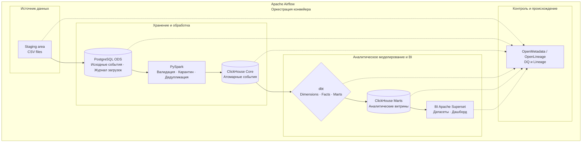

# E-commerce DWH — хранилище и аналитическая платформа пользовательских событий

Проект полного цикла разработки DWH для e-commerce: от загрузки исходных событий и построения многоуровневого хранилища до аналитического моделирования, контроля качества данных, Data Lineage и BI-визуализации.

В проекте реализованы ETL/ELT-конвейер на `Python`, `PySpark`, `PostgreSQL` и `ClickHouse`, аналитические модели на `dbt`, оркестрация в `Apache Airflow` и интеграция с `OpenMetadata`. Решение демонстрирует практические навыки проектирования DWH, разработки воспроизводимых процессов обработки данных и подготовки аналитической инфраструктуры для бизнес-исследований.

## Содержание

- [О проекте](#о-проекте)
- [Ключевые особенности](#ключевые-особенности)
- [Ключевые навыки](#ключевые-навыки)
- [Бизнес-задача](#бизнес-задача)
- [Цель и задачи](#цель-и-задачи)
- [Источник данных](#источник-данных)
- [Архитектура](#архитектура)
- [Модель данных](#модель-данных)
- [Контроль качества данных](#контроль-качества-данных)
- [Data Lineage](#data-lineage)
- [BI-слой](#bi-слой)
- [Технологический стек](#технологический-стек)
- [Структура проекта](#структура-проекта)
- [Выполненные задачи](#выполненные-задачи)
- [Результат проекта](#результат-проекта)
- [Документация](#документация)

## О проекте

`ecom_mcs_dwh` — проект разработки аналитического DWH для исследования пользовательского пути в e-commerce.

Задача проекта — организовать данные так, чтобы большой объем исходных событий можно было последовательно обрабатывать, проверять, преобразовывать в аналитические сущности и использовать в BI. Для этого построена многоуровневая архитектура хранения с разделением загрузки, распределённой обработки, аналитического моделирования и представления данных.

Реализация охватывает полный технический цикл:

- загрузка исходных CSV-файлов из staging area в PostgreSQL ODS;
- очистка, валидация и дедупликация событий с помощью PySpark;
- хранение обработанных атомарных событий в ClickHouse Core;
- построение измерений, фактов и витрин средствами dbt;
- оркестрация конвейера в Apache Airflow;
- контроль качества и происхождения данных через OpenMetadata и OpenLineage;
- подготовка данных для визуализации в Apache Superset.

Проект ориентирован на задачи Data Engineering и аналитической инфраструктуры, непосредственно связанные с работой Data Analyst и BI Analyst: SQL, моделирование данных, качество, согласованность и доступность аналитических показателей.

## Ключевые особенности

- Многоуровневая архитектура DWH. Разделение ODS, Core и Marts с использованием PostgreSQL и ClickHouse;
- Большой событийный набор данных. Обработка сотен миллионов записей. PySpark для подготовки и дедупликации;
- Аналитическое моделирование. Факты, измерения и специализированные витрины строятся в dbt;
- Инкрементальный конвейер. Обработка по датам загрузки, повторный запуск отдельных этапов и идемпотентные операции там, где они предусмотрены реализацией;
- Оркестрация и управление сбоями. Airflow управляет последовательностью задач, повторами, тайм-аутами и остановкой конвейера при критических ошибках;
- Data Quality на нескольких уровнях. Python-проверки контролируют переходы между слоями, а тесты dbt — свойства аналитических моделей;
- Сквозной Data Lineage. Регистрация зависимостей между источниками, слоями хранения, моделями и BI-объектами;
- Интеграция с BI. Аналитические витрины подготовлены для использования в Apache Superset.

## Ключевые навыки

| Область | Реализованные компетенции |
|---|---|
| DWH и архитектура данных | Многоуровневое хранилище, разделение ответственности слоёв, проектирование потока данных |
| SQL и моделирование | PostgreSQL, ClickHouse SQL, факты, измерения, аналитические витрины, инкрементальные модели |
| ETL/ELT и обработка | Python, PySpark, пакетная загрузка, обработка больших CSV, очистка и дедупликация |
| dbt | Моделирование данных, materialization, инкрементальная обработка, generic и singular tests |
| Оркестрация | Apache Airflow, зависимости задач, параметры запуска, retries, timeout, управление ошибками |
| Data Quality | Проверки полноты, допустимости значений, уникальности, целостности и согласованности между слоями |
| Data Lineage | OpenLineage, OpenMetadata, регистрация зависимостей и результатов проверок |
| BI | Apache Superset, подготовка витрин для визуализации, проектирование и разработка дашбоарда |
| Документация | Документация архитектуры и модели данных |

## Бизнес-задача

В e-commerce события пользовательского поведения сами по себе не образуют готовую аналитическую модель. Для исследования конверсии и покупательского поведения требуется связать события, пользователей, товары, категории, сессии и покупки, обеспечить согласованность данных и подготовить показатели для анализа.

Бизнес-задача проекта — создать согласованный аналитический слой для исследования пользовательского пути в e-commerce: от просмотра товара до покупки, включая поведение в сессиях, прохождение воронки и коммерческие результаты.

## Цель и задачи

Цель: разработать воспроизводимую DWH-платформу, которая преобразует исходные события интернет-магазина в контролируемые аналитические данные и витрины.

Для достижения цели необходимо:

1. Организовать загрузку и хранение исходных событий с фиксацией метаданных и результатов загрузки.
2. Реализовать обработку, валидацию и дедупликацию данных перед загрузкой в аналитическое хранилище.
3. Спроектировать слои хранения и аналитическую модель с фактами, измерениями и витринами.
4. Настроить инкрементальную обработку и безопасные повторные запуски соответствующих этапов.
5. Реализовать проверки качества данных и согласованности между слоями.
6. Организовать оркестрацию конвейера и обработку ошибок.
7. Обеспечить прослеживаемость данных от источников до аналитических и BI-объектов.
8. Подготовить витрины для визуального исследования показателей в Apache Superset.

## Источник данных

| Характеристика | Описание |
|---|---|
| Источник | Набор событий пользовательского поведения в интернет-магазине |
| Период наблюдения | Октябрь 2019 — апрель 2020 года |
| Гранулярность | Одно пользовательское событие |
| Объём данных | ~410 млн событий в полном наборе данных |
| Типы событий | `view`, `cart`, `remove_from_cart`, `purchase` |
| Основные атрибуты | Время и тип события, товар, категория, бренд, цена, пользователь, пользовательская сессия |

Исходный набор представлен CSV-файлами с месячными данными. Ключевые атрибуты позволяют анализировать последовательности событий, товарные взаимодействия, сессии и покупки.

Производные показатели и агрегаты формируются на последующих этапах обработки и аналитического моделирования, а не считаются готовыми метриками исходного датасета.

## Архитектура

Архитектура разделяет хранение исходных данных, обработку событий, аналитическое моделирование и потребление данных. PostgreSQL и ClickHouse выполняют разные роли, PySpark отвечает за обработку событий, а dbt — за построение аналитических моделей.

### Поток данных



### Архитектурные решения

**Разделение слоёв хранения**

- `ODS — PostgreSQL`. Приём исходных событий, сохранение исходных атрибутов и метаданных загрузки, хранение, ведение журнала загрузок;
- `Core — ClickHouse`. Хранение обработанных атомарных событий после валидации и дедупликации;
- `Marts — ClickHouse`. Аналитические модели и агрегированные представления, подготовленные для BI-сценариев;
- `BI — Apache Superset`. Дашборды и исследование аналитических метрик.

**Аналитическое моделирование**

В Core сохраняется событийная гранулярность. Поверх неё dbt строит измерения пользователей, товаров и категорий, факты покупок и сессий, а также специализированные витрины. Такой подход сочетает многоуровневую архитектуру хранения с `dimensional modeling` — моделированием через факты, измерения и витрины.

**Инкрементальная обработка**

Конвейер поддерживает обработку по датам и повторные запуски. Идемпотентность обеспечивается на уровне соответствующих операций загрузки и преобразования, в том числе через повторную обработку затронутых данных. Это снижает риск дублирования при восстановлении после сбоев.

**Оркестрация и контроль**

Airflow управляет порядком выполнения этапов, параметрами запуска, повторами и тайм-аутами. Бизнес-логика обработки остаётся в специализированных компонентах, а Python-гейты и тесты dbt проверяют качество и согласованность данных.

**Качество и происхождение данных**

OpenMetadata используется для представления результатов Data Quality и Data Lineage. OpenLineage передаёт события выполнения конвейера, а для отдельных преобразований, зависимости которых не извлекаются автоматически, предусмотрена дополнительная регистрация связей.

## Модель данных

Модель строится вокруг атомарного события пользовательского поведения. На этом уровне сохраняется факт взаимодействия пользователя с товаром, а последующие модели формируют сущности и показатели для различных аналитических сценариев.

| Уровень | Объекты | Назначение |
|---|---|---|
| Core | `fact_events` | Базовый слой обработанных атомарных пользовательских событий |
| Dimensions | `dim_user`, `dim_product`, `dim_category` | Пользователи, товары и категории |
| Facts | `fact_purchases`, `fact_sessions` | Покупки и пользовательские сессии |
| Marts | `mart_funnel`, `mart_sessions`, `mart_products`, `mart_users`, `mart_sales` | Витрины для анализа воронки, сессий, товаров, пользователей и продаж |

Модели реализованы в dbt и материализуются в ClickHouse. Для инкрементальных моделей определены стратегии обновления данных, а тесты проверяют ключевые свойства моделей и их согласованность.

Подробнее о [схемах данных](docs/data_model/schema.md) и [словаре данных](docs/data_model/data_dictionary.md).

## Контроль качества данных

Data Quality встроен в конвейер и охватывает как переходы между слоями, так и аналитические модели.

Основные направления проверок:

- Структура и полнота: соответствие входных файлов контракту, наличие ожидаемых загрузок и согласованность количества записей;
- Валидность: допустимые значения, типы событий и временные границы;
- Уникальность и целостность: ключи и обязательные свойства моделей;
- Согласованность: сверки между ODS, Core, фактами и витринами;
- Гранулярность и метрики: соблюдение ожидаемого уровня детализации и ограничений показателей.

Критические ошибки блокируют дальнейшее выполнение соответствующего участка конвейера. Результаты тестов передаются в OpenMetadata, где доступны состояние проверок и сведения о покрытии активов.


Рис. Сводная панель Data Quality: состояние тестов и покрытие активов

Подробнее о [Data Quality](docs/data_quality/README.md).

## Data Lineage

Data Lineage связывает источники, слои хранения, аналитические модели и BI-объекты, позволяя исследовать происхождение данных и зависимости между компонентами.

В проекте используются OpenMetadata и OpenLineage. Автоматическая регистрация дополняется явным описанием отдельных зависимостей, которые нельзя достоверно восстановить из метаданных выполнения.


Рис. Пример графа происхождения данных: путь от исходного источника до аналитической витрины и BI-объекта

Подробнее о [Data Lineage](docs/data_lineage/README.md).

## BI-слой

BI-слой построен на Apache Superset, подключённый к аналитическим витринам ClickHouse. Реализованы датасеты и дашборд **E-commerce Customer Journey** для исследования пользовательского пути и связанных с ним метрик, без необходимости обращаться к исходным событиям напрямую.


Описание структуры BI-слоя и его компонентов приведено в [документации BI](docs/bi/README.md).

## Технологический стек

| Направление | Технологии |
|---|---|
| Язык и обработка данных | Python, PyArrow, PySpark |
| Операционное хранение | PostgreSQL |
| Аналитическое хранение | ClickHouse |
| Аналитическое моделирование | dbt, SQL |
| Оркестрация | Apache Airflow |
| BI | Apache Superset |
| Data Quality и каталогизация | OpenMetadata |
| Data Lineage | OpenLineage, OpenMetadata |

## Структура проекта

```text
ecom_mcs_dwh/
├── .gitignore
├── README.md
├── requirements.txt
├── config/
│   ├── __init__.py
│   ├── config.py
│   ├── config_local.py
│   └── loader.py
├── data/
│   ├── quarantine/
│   ├── staging/
│   ├── raw/
│   │   ├── 2019-10.csv
│   │   ├── 2019-11.csv
│   │   └── ...
│   └── sample/
│       └── events.csv
├── airflow/
│   └── dags/
│       └── ecom_mcs_dwh_daily_pipeline.py
├── src/
│   ├── db/
│   │   ├── __init__.py
│   │   ├── init_core.py
│   │   └── init_ods.py
│   ├── ingestion/
│   │   ├── __init__.py
│   │   └── load_ods.py
│   ├── lineage/
│   │   ├── dq.py
│   │   ├── emit_csv.py
│   │   ├── emit_dbt_test_results.py
│   │   ├── emit_dbt.py
│   │   ├── emit_spark.py
│   │   └── ol.py
│   ├── pyspark/
│   │   ├── __init__.py
│   │   └── deduplicate_events.py
│   ├── utils/
│   │   ├── __init__.py
│   │   ├── logging.py
│   │   ├── timer.py
│   │   └── sql.py
│   └── validation/
│       ├── csv_ods_check.sql
│       └── integration_check.py
├── sql/
│   ├── checks/
│   ├── ods/
│   │   ├── 01_schema.sql
│   │   ├── 02_tables.sql
│   │   ├── 03_indexes.sql
│   │   ├── 04_analyze.sql
│   │   └── 05_maintenance.sql
│   └── core/
│       ├── 01_database.sql
│       ├── 02_fact_events.sql
│       └── 03_settings.sql
├── dbt/
│   ├── dbt_project.yml
│   ├── profiles.yml
│   ├── ingestion/
│   │   ├── dbt_core.yml
│   │   └── dbt_marts.yml
│   ├── models/
│   │   ├── dimensions/
│   │   │   ├── dim_user.sql
│   │   │   ├── dim_product.sql
│   │   │   └── dim_category.sql
│   │   ├── facts/
│   │   │   ├── fact_sessions.sql
│   │   │   ├── fact_purchases.sql
│   │   │   └── schema.yml
│   │   └── marts/
│   │       ├── mart_funnel.sql
│   │       ├── mart_sessions.sql
│   │       ├── mart_products.sql
│   │       ├── mart_users.sql
│   │       ├── mart_sales.sql
│   │       └── schema.yml
│   ├── macros/
│   │   ├── custom_schema.sql
│   │   └── incremental_filter.sql
│   ├── logs/
│   ├── target/
│   ├── tests/
│   └── seeds/
├── superset/
│   ├── charts/
│   ├── dashboards/
│   ├── databases/
│   ├── datasets/
│   └── queries/
├── notebooks/
├── docs/
│   ├── README.md
│   ├── architecture/
│   │   ├── architecture.md
│   │   └── data_flow.md
│   ├── data_model/
│   │   ├── schema.md
│   │   └── data_dictionary.md
│   ├── data_lineage/
│   ├── data_quality/
│   ├── bi/
│   │   ├── README.md
│   │   ├── datasets/
│   │   │   ├── mart_funnel.md
│   │   │   ├── mart_sessions.md
│   │   │   ├── mart_products.md
│   │   │   ├── mart_users.md
│   │   │   └── mart_sales.md
│   │   └── dashboards/
│   │       └── ecom_overview.md
│   └── analysis/
├── dist/
└── ...
```

## Выполненные задачи

- Разработана структура DWH с разделением ODS, Core и Marts;
- Реализована пакетная загрузка CSV в PostgreSQL с журналированием и метаданными загрузки;
- Реализована обработка событий с использованием PySpark, включая валидацию и дедупликацию;
- Подготовлен атомарный слой событий в ClickHouse;
- Разработаны dbt-модели измерений, фактов и аналитических витрин;
- Настроена инкрементальная обработка и повторные запуски для соответствующих этапов;
- Реализован DAG Airflow для оркестрации конвейера;
- Добавлены Python-гейты и тесты dbt для контроля качества и согласованности данных;
- Настроена передача результатов Data Quality и регистрация Data Lineage в OpenMetadata;
- Подготовлены BI-датасеты и дашборд в Apache Superset;
- Подготовлена документация по архитектуре, потоку данных, модели, качеству, происхождению данных и BI-слою.

## Результат проекта

Реализована DWH-платформа, объединяющая загрузку исходных данных, обработку событий, аналитическое моделирование, контроль качества, Data Lineage и BI-визуализацию.

Проект демонстрирует способность самостоятельно реализовать ключевые компоненты аналитической инфраструктуры: от организации хранения и обработки данных до построения моделей, тестирования и подготовки витрин для конечного потребителя.

## Документация

- **Архитектура:** [Архитектура системы](docs/architecture/architecture.md), [Поток данных](docs/architecture/data_flow.md).
- **Модель данных:** [Схема данных](docs/data_model/schema.md), [Словарь данных](docs/data_model/data_dictionary.md).
- **Data Quality:** [Обзор и документация проверок](docs/data_quality/README.md).
- **Data Lineage:** [Обзор и документация происхождения данных](docs/data_lineage/README.md).
- **BI:** [Документация BI-слоя](docs/bi/README.md).
- **Airflow:** [Оркестрация конвейера](docs/architecture/airflow.md).
