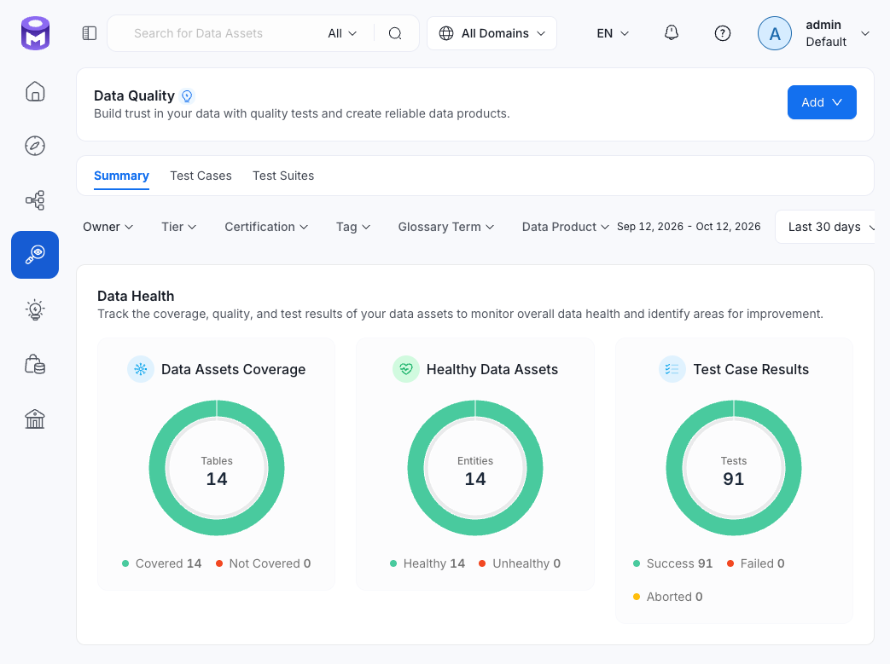

# Архитектура DWH

## 1. Назначение

`ecom_mcs_dwh` — аналитическое хранилище данных DWH для загрузки, обработки, хранения, аналитики и контроля больших объёмов данных событий пользовательского поведения в e-commerce.


Основные задачи DWH:

1. Преобразование исходных данных событий в согласованные, проверенные и пригодные для аналитики данные. Для этого архитектура разделяет хранение исходных данных, обработку событий, формирование аналитической модели и предоставление данных потребителям.

2. Бизнес-задача проекта — анализ customer journey: от просмотра товара до добавления в корзину и покупки. Аналитическая модель поддерживает исследование воронки, сессий, поведения пользователей и товаров, а также продаж.

3. Задача контроля данных — проверка качества на границах слоёв и отслеживание происхождения данных от исходных CSV-файлов до BI-дашбордов.

## 2. Архитектурные особенности

- Многоуровневое хранение: данные проходят через ODS, Core и аналитические модели. Каждый слой имеет собственное назначение и правила обработки;
- Разделение операционного и аналитического хранения: PostgreSQL используется для приёма исходных событий, ClickHouse — для хранения обработанных данных и аналитических запросов;
- Событийная модель: базовая сущность — событие пользовательского взаимодействия с товаром, дополненное временными и техническими атрибутами;
- Пакетная обработка: исходные данные поступают и обрабатываются дневными партиями;
- Контроль качества: проверки выполняются на границах слоёв и в аналитических моделях;
- Контроль на границах: проверки выявляют нарушения контракта, потери, дубли и расхождения между слоями;
- Прослеживаемость: Data Lineage связывает источники, таблицы, модели и BI-дашборды;
- Разделение ответственности: загрузка, обработка, аналитическое моделирование и BI реализованы отдельными компонентами;
- Модульность: обработка, проверки, dbt-модели и эмиттеры разделены по назначению.


## 3. Общая схема

Хранилище построено на PostgreSQL и ClickHouse. Аналитическая модель реализована с помощью dbt, а Apache Superset используется для визуализации данных.

```text
┌───────────────────────────────┐
│ Source: monthly CSV files     │
└───────────────┬───────────────┘
                ▼
┌───────────────────────────────┐
│ ODS: PostgreSQL               │
│ Исходные события и журнал     │
│ загрузок                      │
└───────────────┬───────────────┘
                ▼
┌───────────────────────────────┐
│ Processing: PySpark           │
│ Проверка, карантин,           │
│ дедупликация                  │
└───────────────┬───────────────┘
                ▼
┌───────────────────────────────┐
│ Core: ClickHouse              │
│ Обработанные события          │
└───────────────┬───────────────┘
                ▼
┌───────────────────────────────┐
│ Analytics: dbt + ClickHouse   │
│ Dimensions → Facts → Marts    │
└───────────────┬───────────────┘
                ▼
┌───────────────────────────────┐
│ BI: Apache Superset           │
│ Аналитические дашборды        │
└───────────────────────────────┘
```

Apache Airflow оркестрирует ежедневное выполнение этапов обработки. Data Quality и Data Lineage работают сквозным образом: первый механизм контролирует корректность данных, второй фиксирует их происхождение и зависимости.

## 4. Слои хранения и обработки

| Слой | Технология | Назначение | Подробнее |
|---|---|---|---|
| Source | CSV | Исходные данные событий  | — |
| ODS | PostgreSQL | Приём исходных данных и журналирование загрузок | [ODS](ods.md) |
| Processing | PySpark | Проверка, карантин некорректных записей и дедупликация | [Processing](processing.md) |
| Core | ClickHouse | Хранение обработанных событий | [Core](core.md) |
| Analytics | dbt + ClickHouse | Измерения, факты и аналитические витрины | [BI и аналитические модели](../bi/README.md) |
| BI | Apache Superset | Визуализация и исследование показателей | [BI](../bi/README.md) |


## 5. Data Quality

Data Quality (DQ) контролирует корректность и согласованность данных на переходах между слоями и при построении аналитических моделей.

Используются три группы проверок:

- python-гейты на границах `CSV -> ODS` и `ODS -> Core` для проверки контракта исходного файла, статуса и согласованности загрузки, количества строк, временных границ, сверки количества и распределения событий, уникальности `event_id`, допустимости типов событий, цен и временных атрибутов;
- generic-тесты dbt для свойств столбцов;
- singular-тесты dbt для бизнес-инвариантов и согласованности аналитических слоёв.

Результаты передаются в витрину OpenMetadata, которая предоставляет централизованное представление результатов проверок. Сам каталог не является механизмом блокировки обработки: решение о продолжении конвейера принимается проверками и оркестрацией.

<!--


Рис. Сводные показатели качества данных в OpenMetadata
-->

Подробнее [Data Quality](../data_quality/README.md).

## 6. Data Lineage

Data Lineage отражает происхождение данных и зависимости между сущностями — это позволяет проследить путь от исходных файлов до аналитических витрин и BI-дашбордов.

Граф в OpenMetadata формируется из нескольких источников метаданных: 
 
- проектных эмиттеров для CSV, PySpark и dbt, которые связывают исходный файл с таблицей ODS, фиксируют переход `ODS -> Core`, формируют зависимости аналитических моделей; 
- OpenLineage, который передаёт события выполнения задач;
- коннектора Superset, который связывает данные с BI-дашбордом.

<!--


Рис. Пример сквозного графа от исходного CSV до BI-дашборда
-->

Подробнее [Data Lineage](../data_lineage/README.md).

## 7. Оркестрация

Apache Airflow управляет последовательностью ежедневной обработки:

1. Загрузка данных в ODS.
2. Публикация Lineage для исходного файла.
3. Проверка CSV -> ODS.
4. Обработка ODS -> Core с помощью PySpark.
5. Публикация Lineage для Core.
6. Проверка ODS -> Core.
7. Обновление dbt manifest и выполнение dbt-моделей.
8. Публикация зависимостей dbt и результатов тестов.

DAG настроен на ежедневный запуск в 03:00. Инициализация схем ODS и Core существует как отдельная функциональность, но не включена в активную цепочку DAG.