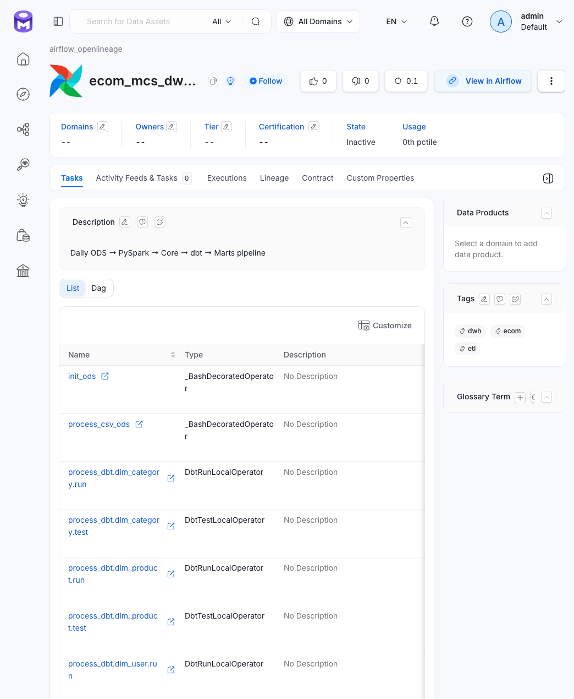

# Архитектура Data Lineage

## Звенья и механизмы построения графа

| Звено | Механизм | Что попадает в OM |
|---|---|---|
| Статусы запусков DAG | Airflow OpenLineage provider, транспорт в `airflow.cfg` | Пайплайн, запуски и статусы задач |
| CSV -> ODS | Таск `emit_csv_lineage`, скрипт `emit_csv.py` | Сущность CSV-таблицы и ребро к `ods.events` |
| ODS -> Core | Таск `emit_spark_lineage`, скрипт `emit_spark.py` | Ребро `ods.events` -> `fact_events` |
| dbt-модели | Таск `emit_dbt_lineage`, скрипт `emit_dbt.py` | Рёбра по зависимостям `depends_on` каждой модели |
| BI, Superset | Superset ingestion-агент OM | Рёбра таблицы -> датасет -> чарт -> дашборд |

## Что строится автоматически, а что задаётся вручную

### 1. Airflow OpenLineage provider

Провайдер описывает собственные задачи и запуски DAG, но не знает о входах и выходах, скрытых внутри Bash-команд. Поэтому он не строит межтабличные зависимости по содержимому команд.

Его роль — регистрация пайплайна и статусов запусков и задач.

### 2. PySpark: ручная фиксация зависимости

Автоматические экстракторы не отслеживают чтение ODS через JDBC и обработку данных через `mapInPandas`. Поэтому зависимость задаётся явно в `src/lineage/emit_spark.py` на основании фактической логики модуля `src.pyspark.deduplicate_events`.

Если PySpark-модуль начинает читать или записывать другие таблицы, списки входов и выходов эмиттера необходимо обновить в том же изменении.

### 3. dbt: граф из `manifest.json`

dbt-зависимости строятся по `dbt/target/manifest.json`, а не по событиям Cosmos.

Cosmos генерирует OpenLineage-события со schema-facet, в котором у полей отсутствуют типы. В текущей конфигурации OM отвергает такие события с ошибкой `400` и сообщением `query param type must not be null`.

Эмиттер `emit_dbt.py` читает `manifest.json` и использует `depends_on` моделей и источников. Это позволяет построить граф dbt без зависимости от проблемного schema-facet.

### 4. CSV: регистрация сущности через REST API

Для сервиса `csv_staging` не используется ingestion-коннектор: сервис служит заглушкой. Поэтому сущность CSV-таблицы регистрирует сам эмиттер через REST PUT на основании заголовка исходного файла.



Рис. Airflow OpenLineage provider: список запусков и статусы задач DAG `ecom_mcs_dwh_daily_pipeline`

## Формат датасета для ручного эмита

Для событий эмиттеров используются два значения:

```text
namespace = имя сервиса OM
name      = полный хвост FQN: база.схема.таблица
```

Пример:

```text
Таблица:
clickhouse_core.ecom_mcs_dwh_core.ecom_mcs_dwh_core.fact_events

namespace = 'clickhouse_core'
name      = 'ecom_mcs_dwh_core.ecom_mcs_dwh_core.fact_events'
```

`namespace` должен совпадать с именем сервиса OM, а `name` — с FQN зарегистрированной в этом сервисе сущности.

Событие привязывается к пайплайну DAG: `job` в событии совпадает с namespace пайплайна, заданным в `airflow.cfg`. В текущей конфигурации события эмиттеров привязываются к существующему пайплайну `ecom_mcs_dwh_daily_pipeline`.

## Размещение эмиттеров в DAG

Эмиттеры размещены сразу после соответствующих этапов обработки, а гейты качества — между этапами. Порядок отражает зависимости задач и должен сохраняться при изменениях DAG.

Текущая последовательность:

```text
process_csv_ods
  -> emit_csv_lineage
    -> test_csv_ods
      -> process_ods_core
        -> emit_spark_lineage
          -> test_ods_core
            -> refresh_dbt_manifest
              -> process_dbt
                -> emit_dbt_lineage
                  -> ingest_dbt_tests
                    -> push_dbt_test_results
```

Особенности:

- `emit_csv_lineage` выполняется до `test_csv_ods`, поскольку CSV-сущность нужна для привязки тест-кейсов;
- `emit_spark_lineage` выполняется после `process_ods_core`, но до `test_ods_core`;
- `refresh_dbt_manifest` обновляет `manifest.json` перед построением dbt-моделей;
- `emit_dbt_lineage` запускается после `process_dbt` и читает manifest, подготовленный задачей `refresh_dbt_manifest`.

`refresh_dbt_manifest` — единственный писатель общего `dbt/target/manifest.json` в этом процессе. Не следует переносить эмиттер dbt перед обновлением manifest или допускать конкурентную запись в этот файл.