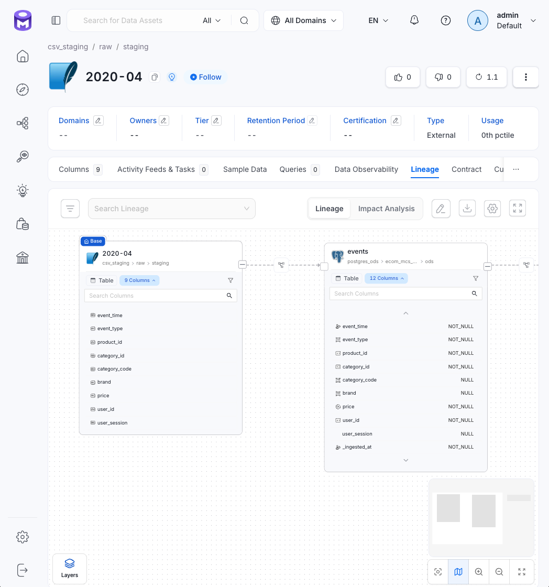

# `emit_csv.py` — звено `CSV -> ODS`

**Файл:** `src/lineage/emit_csv.py`  
**Таск DAG:** `emit_csv_lineage`  
**Положение в DAG:** сразу после `process_csv_ods`.

## Что делает эмиттер

1. Читает заголовок CSV-файла — первую строку с названиями колонок.
2. Регистрирует таблицу `csv_staging.raw.staging.<ГГГГ-ММ>` на основании заголовка через `register_csv_table` из `ol.py`.
3. Создаёт ребро от CSV-сущности к `postgres_ods.ecom_mcs_dwh.ods.events`.

Рис. Сущность `csv_staging.raw.staging.2020-04` в OM: колонки взяты из заголовка, тип таблицы — External

Для нового месяца дополнительных действий не требуется: сущность и ребро создаются при первом запуске эмиттера для соответствующего файла.

## Поведение при отсутствии файла

Если CSV-файл отсутствует, например при backfill месяца без данных, скрипт завершается без создания сущности и ребра.

Такое поведение согласовано с гейтом `test_csv_ods`: при отсутствии файла этап не должен создавать фиктивный источник. Если отсутствие файла неожиданно для конкретного запуска, это следует диагностировать отдельно, а не считать доказательством успешной загрузки данных.

## Особенности и ограничения

- За проверку заголовка относительно контракта источника отвечает `csv_header_matches_contract` в гейте `test_csv_ods`. См. [csv_ods_check.md](../../data_quality/tests/gates/csv_ods_check.md).
- Если набор колонок в файле изменился, следующий вызов PUT обновит колонки зарегистрированной сущности.
- Для второго CSV-источника, например файлов возвратов, следует использовать отдельную схему в `csv_staging` — например, `raw.returns.<файл>` — или отдельный сервис. Имя таблицы по-прежнему не должно содержать точек.
- Точка входа защищена `if __name__ == "__main__"`. Без этой защиты запуск через `python -m` может импортировать модуль, не выполнив основную логику. Сохранять защиту при копировании скрипта как шаблона.