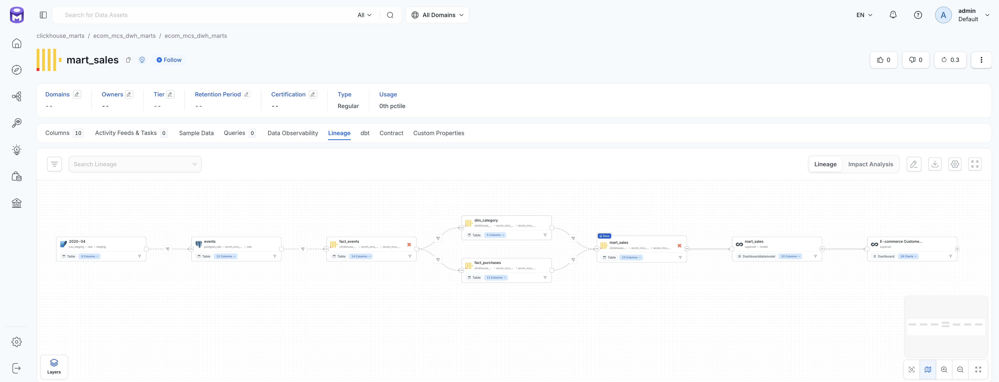

# Назначение и итоговый граф

## Назначение

Пайплайн состоит из нескольких этапов, и каждый из них видит только часть зависимостей:

- PySpark работает только с данными между ODS и Core;
- dbt описывает зависимости моделей ClickHouse;
- Superset связывает аналитические датасеты с визуализациями.

Lineage объединяет эти зависимости в единый граф в OpenMetadata (OM).

Он позволяет ответить на практические вопросы:

- какие downstream-объекты затронет изменение структуры источника;
- кто использует таблицу, прежде чем её изменять или удалять;
- через какие этапы прошло значение, отображаемое на дашборде, вплоть до исходного CSV-файла.

## Итоговый граф

### Логический (сквозной) путь данных

```text
CSV (data/raw/<ГГГГ-ММ>.csv)
  -> PostgreSQL ODS (ods.events)
    -> PySpark (очистка и дедупликация)
      -> ClickHouse Core (fact_events, dim_*, fact_*)
        -> dbt-модели
          -> ClickHouse Marts (mart_*)
            -> Superset (датасет -> чарт -> дашборд)
```

### Путь в терминах сущностей OpenMetadata

```text
csv_staging.raw.staging.<файл>
  -> postgres_ods.ecom_mcs_dwh.ods.events
    -> clickhouse_core.ecom_mcs_dwh_core.ecom_mcs_dwh_core.fact_*/dim_*
      -> clickhouse_marts.ecom_mcs_dwh_marts.ecom_mcs_dwh_marts.mart_*
        -> superset.model.<id> (датасет Superset)
          -> superset.<id> (дашборд «E-commerce Customer Journey»)
```



Рис. OM Explore Lineage для `mart_sales`: полный граф из восьми узлов от CSV до дашборда

## Проверенные принципы

1. **Ребро создаётся только между существующими сущностями.**  
   OpenLineage endpoint OM принимает события и создаёт ребра, но не регистрирует отсутствующие сущности (датасеты). Таблицы создают ingestion-коннекторы или REST API. Если датасет не существует, ответ может быть `200` с сообщением `no lineage edges created`. Сам по себе такой ответ не подтверждает, что ребро появилось.

2. **Для ручных эмиттеров используются namespace сервиса и хвост FQN.**  
   `namespace` — имя сервиса OM, например `postgres_ods` или `clickhouse_core`. `name` — полный хвост FQN в формате `база.схема.таблица`.

   JDBC-формат адреса, например `postgres://host:port/db`, поддерживается, но не подходит для данного проекта: два ClickHouse-сервиса работают на одном `host:port`, поэтому такое разрешение датасета может привязать ребро к неправильной копии таблицы.

3. **Точка в имени таблицы является разделителем FQN.**  
   CSV-файл `2020-04.csv` регистрируется как таблица `2020-04`, без расширения. Имя с точкой интерпретировалось бы как несколько уровней FQN.

4. **Ошибки отправки событий эмиттерами не блокируют загрузку данных.**  
   Ошибки логируются, но не пробрасываются наружу. Lineage служит для наблюдаемости зависимостей, а не является блокирующим гейтом загрузки.

5. **Cosmos listener остаётся включённым.**  
   Его события нужны для обновления статусов задач DAG в OM. Ошибки `400`, возникающие из-за schema-facet без типов полей, не заменяют построение dbt-графа и не требуют отключения listener: зависимости dbt строит отдельный эмиттер.

6. **Ingestion-сервисы должны иметь include-фильтры схем.**  
   Без фильтров коннектор может обнаруживать таблицы из обеих баз ClickHouse. Это приводит к дубликатам сущностей и рёбрам, привязанным не к той копии таблицы.

Эти принципы проверены на практике в текущей конфигурации проекта.

## Границы lineage

Lineage отображает зависимости между сущностями, но не раскрывает полную семантику преобразований.

Например, этап PySpark представлен одним ребром `ods.events` -> `fact_events`, хотя внутри выполняются очистка, дедупликация и генерация ключей. Эти детали следует проверять в коде соответствующего этапа.

Условия качества данных и проверки, контролирующие переходы между слоями, описаны отдельно в [Data Quality](../data_quality/README.md)