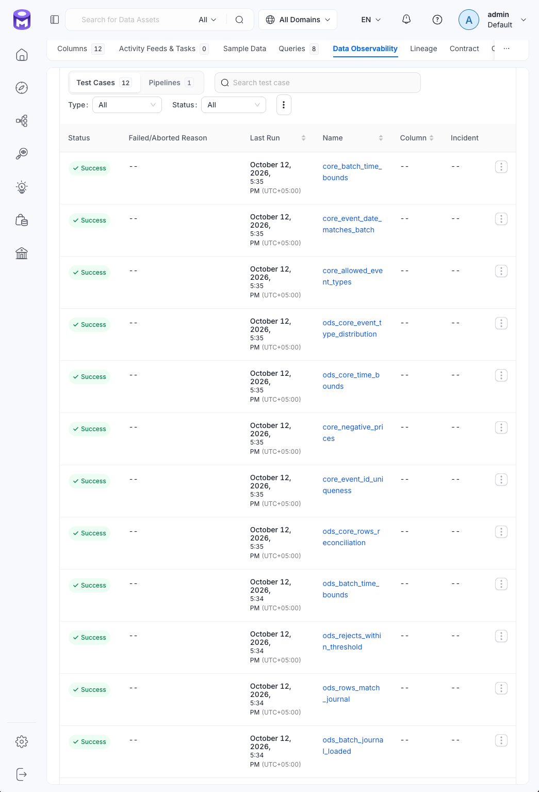

# Архитектура

## Механизмы контроля

| Механизм | Расположение | Что проверяет | Что блокирует |
|---|---|---|---|
| Python-гейты | `src/validation/` | Границы `CSV -> ODS`, `ODS -> Core`, журнал загрузок | Airflow-таск при ненулевом коде завершения |
| dbt generic-тесты | `dbt/models/<слой>/schema.yml` | Свойства колонок: заполненность, уникальность, допустимые значения | `dbt build` |
| dbt singular-тесты | `dbt/tests/*.sql` | Инварианты таблиц, грейн, бизнес-правила и сверки слоёв | `dbt build` |

Выбор механизма по области проверки описан в [overview.md](overview.md), добавление и сопровождение — в [procedures.md](procedures.md).

## Контрольные точки в конвейере

```text

CSV-файл месяца
    |
test_csv_ods                         гейт CSV -> ODS
    |
PostgreSQL ODS
    |
process_ods_core                     PySpark: очистка и дедупликация
    |
emit_spark_lineage
    |
test_ods_core                        гейт ODS -> Core
    |
ClickHouse Core
    |
refresh_dbt_manifest
    |
process_dbt (Cosmos / dbt build)     сначала модели, затем тесты AFTER_ALL
    |
emit_dbt_lineage
    |
ingest_dbt_tests
    |
push_dbt_test_results

```

Гейты — Airflow-таски, запускающие Python-модули из `src/validation/`. Модуль собирает результаты доступных проверок и отправляет их в OM в режиме best-effort. Если есть провалы, он завершает работу исключением: таск становится `Failed`, и Airflow не запускает нисходящие таски. Повторы выполняются штатными средствами Airflow.

dbt-тесты работают внутри `process_dbt` (Cosmos `DbtTaskGroup`). При `TestBehavior.AFTER_ALL` сначала строятся все модели, затем выполняется общий прогон тестов. Поэтому dbt-контур не предотвращает материализацию некорректной витрины: он останавливает конвейер после построения моделей.

Если тест падает, `dbt build` возвращает ненулевой код, таск `process_dbt` становится красным. Нисходящие таски `emit_dbt_lineage`, `ingest_dbt_tests` и `push_dbt_test_results` не выполняются; обновление lineage и результатов тестов в OM пропускается.


Рис. Airflow: `process_dbt` сначала запускает модели, затем выполняет один общий прогон `dbt_test`

Различия между контурами:

| Контур | Что предотвращает | Точка контроля |
|---|---|---|
| `test_csv_ods` | Передачу некорректного ODS в PySpark | До PySpark |
| `test_ods_core` | Передачу некорректного Core в dbt | До dbt |
| dbt-тесты | Продвижение конвейера к lineage и публикации результатов в OM | После построения моделей и витрин |

> При провале dbt-теста модели уже материализованы. Нужно устранить причину в модели или входных данных и повторно запустить соответствующий процесс, а не ограничиваться просмотром результата теста.

Результаты проверок отображаются в OpenMetadata. OM отвечает за представление результатов; решение о блокировке принимается в Python-гейтах или dbt.

### Почему границы этапов проверяет Python, а не dbt?

dbt подключён к ClickHouse, а проверка `ODS = journal.rows_loaded` требует одновременно PostgreSQL и журнал загрузки. Такую межсистемную сверку нельзя выполнить только средствами dbt в текущей архитектуре. Поэтому проверки, выходящие за пределы ClickHouse, реализованы Python-гейтами. Проверки внутри ClickHouse выполняются dbt-тестами.

## Путь результатов в OpenMetadata

Результаты отправляются в OM двумя основными путями:

| Источник | Механизм отправки | Точка в DAG |
|---|---|---|
| Python-гейты 1 и 2 | Прямой REST-вызов через `src/lineage/dq.py` | Внутри самих гейтов |
| dbt-тесты | dbt-коннектор OM читает `run_results.json` | `ingest_dbt_tests` |
| dbt-тесты, которые коннектор не может привязать к таблице | Скрипт `src/lineage/emit_dbt_test_results.py` отправляет результаты напрямую | `push_dbt_test_results` |

Жизненный цикл проверки:

```text
Свойство данных
    -> тест (SQL или Python)
    -> результат (успех или нарушение)
    -> блокировка конвейера при провале
    -> публикация результата в OM (best-effort)
```



Рис. Результаты Python-гейта на странице `postgres.ods.events`, вкладка Data Quality: список кейсов гейта со статусами

Проверка и публикация результата независимы. Если OM недоступен, гейт всё равно блокирует конвейер при провале. И наоборот: зелёный таск не гарантирует, что результат появился в OM. Диагностика описана в [procedures.md](procedures.md).

## Идемпотентность и повторы

Гейты работают только на чтение, поэтому безопасны для повторного запуска.

При повторной загрузке дня:

- `load_ods` удаляет и повторно загружает соответствующий batch;
- гейты повторно проверяют данные;
- OM получает новый `TestCaseResult`; история результатов сохраняется по timestamp.