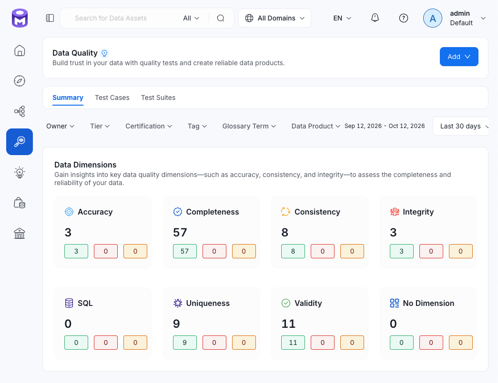
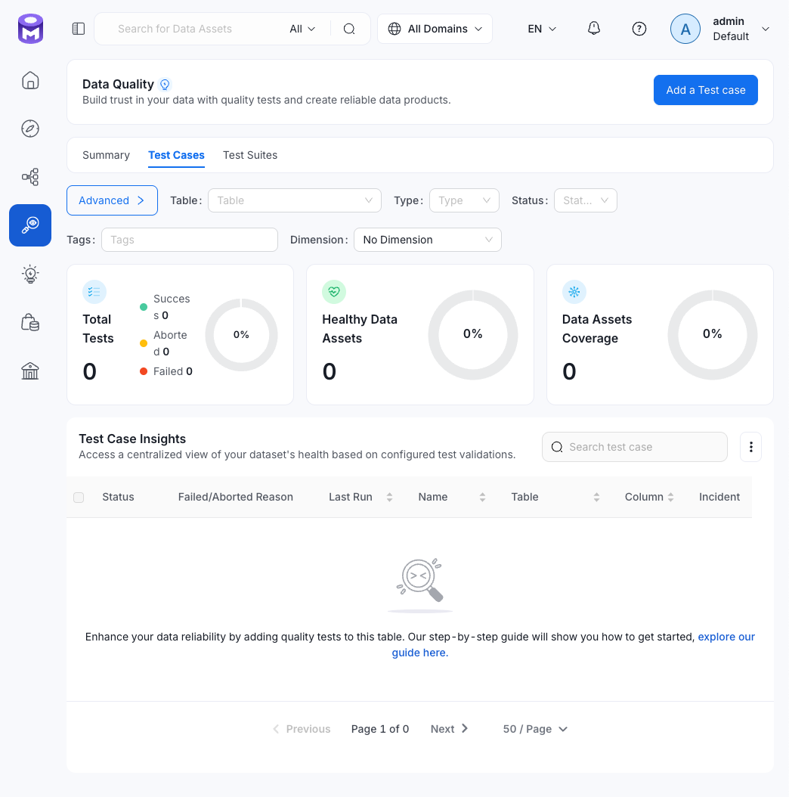

# Соглашение об именах тестов

Имя dbt-теста используется для назначения dimension в OpenMetadata. Патч dbt-коннектора сопоставляет подстроки имени со значениями из словаря `_DBT_DIMENSION`. Для Python-гейтов dimension передаётся явно через `dataQualityDimension` в `src/lineage/dq.py`.

## Правило именования

Рекомендуемый шаблон:

```text
<носитель>_<тип>
```

Где носитель — таблица или слой, а тип — суффикс, который соответствует ключу словаря dimension.

Примеры:

```text
fact_purchases_unique    # таблица + unique
marts_grain.             # слой + grain
fact_sessions_validity   # таблица + validity  
```

## Шаблоны и dimension

| Подстрока имени | Dimension | Пример |
|---|---|---|
| `not_null` | Completeness | `fact_sessions_user_id_not_null` |
| `required` | Completeness | `dim_category_required` |
| `accepted_values` | Validity | `mart_funnel_funnel_stage_accepted_values` |
| `unique` | Uniqueness | `fact_sessions_session_id_unique` |
| `_grain` | Uniqueness | `marts_grain` |
| `integrity` | Integrity | `core_integrity` |
| `reconciliation` | Consistency | `core_marts_reconciliation` |
| `validity`, `valid_dates` | Validity | `fact_sessions_validity`, `dim_user_valid_dates` |
| `positive` | Validity | `fact_purchases_positive_price` |
| `metrics`, `_idempotency` | Accuracy | `marts_non_negative_metrics` |
| Прочие имена | NoDimension | — |



Рис. Data Dimensions в OM: Accuracy, Completeness, Consistency, Integrity и Uniqueness

## Словарь `_DBT_DIMENSION`

Актуальный словарь находится в патче dbt-коннектора:

```python
_DBT_DIMENSION = {
    'not_null': 'Completeness',
    'accepted_values': 'Validity',
    'integrity': 'Integrity',
    'reconciliation': 'Consistency',
    '_grain': 'Uniqueness',
    'unique': 'Uniqueness',
    'valid_dates': 'Validity',
    'required': 'Completeness',
    'positive': 'Validity',
    'validity': 'Validity',
    'metrics': 'Accuracy',
    '_idempotency': 'Accuracy',
}
```

Поиск выполняется по вхождению подстроки в имя (`p in manifest_node.name`). Реализация описана в [om_dbt_connector_patch.md](om_dbt_connector_patch.md).

## Правила сопровождения

При добавлении нового типа dbt-теста:

1. Добавить тип в словарь, если для него требуется отдельная dimension.
2. Назвать файл теста по согласованному шаблону.
3. Проверить, что нужная подстрока целиком входит в имя.
4. Добавить тест в [матрицу покрытия](tests/README.md) и соответствующую карточку.

Для тестов, которые должны отображаться как NoDimension, использовать имя без подстрок из словаря.

Подстроки могут совпадать с частью более длинного имени. Например, `validity` распознаётся в `fact_sessions_validity`, а `valid_dates` — в `dim_user_valid_dates`. Ключ `valid_dates` сохраняется в словаре отдельно, хотя оба имени относятся к Validity.



Рис. Фильтр No Data Dimensions в OM

## Python-кейсы гейтов

Python-кейсы не проходят через dbt-коннектор: dimension задаётся явно в `dq.py`. Среди имён проверок:

- `csv_header_matches_contract`;
- `ods_rows_match_journal`;
- `core_event_date_matches_batch`.

При добавлении Python-кейса нужно задать dimension в `dq.py` и обновить карточку гейта и [матрицу](tests/README.md).

## Ограничение dbt-коннектора OpenMetadata

Для singular-тестов коннектор определяет таблицу-носитель по зависимостям теста:

- Если тест читает только модели через `ref`, коннектор может определить таблицу и создать кейс. Так работают, например, `marts_grain`, `marts_non_negative_metrics`, `mart_funnel_metrics` и `fact_sessions_validity`.
- Если тест одновременно читает модель и источник через `ref` и `source`, коннектор не может однозначно выбрать таблицу и не создаёт кейс. Примеры: `reconciliation_core_marts`, `reconciliation_core_purchases`, `reconciliation_core_sessions`.

dbt по-прежнему выполняет такие тесты и блокирует конвейер при провале. Теряется только автоматическая видимость результата в OM. Для этих тестов таск `push_dbt_test_results` запускает `src/lineage/emit_dbt_test_results.py` и отправляет результаты напрямую на `fact_events` — общий источник сверок.

При сопровождении:

- для нового теста с `ref` и `source` добавить имя теста и таблицу-носитель в `PUSH_CASES` скрипта;
- если новая версия коннектора начнёт создавать этот кейс самостоятельно, удалить его из `PUSH_CASES`, чтобы избежать дубля.