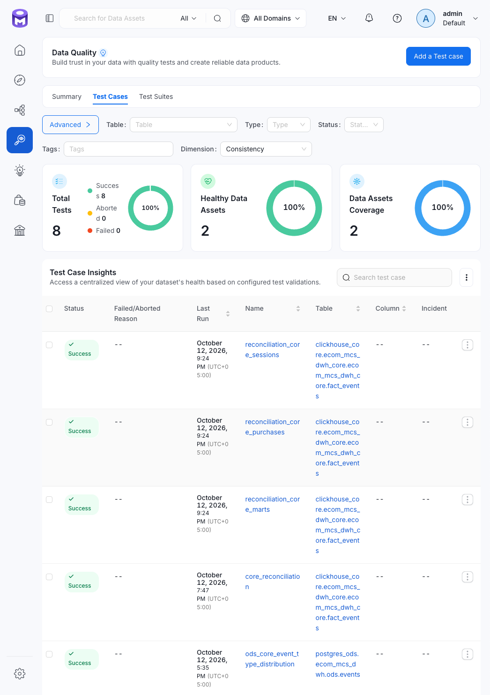
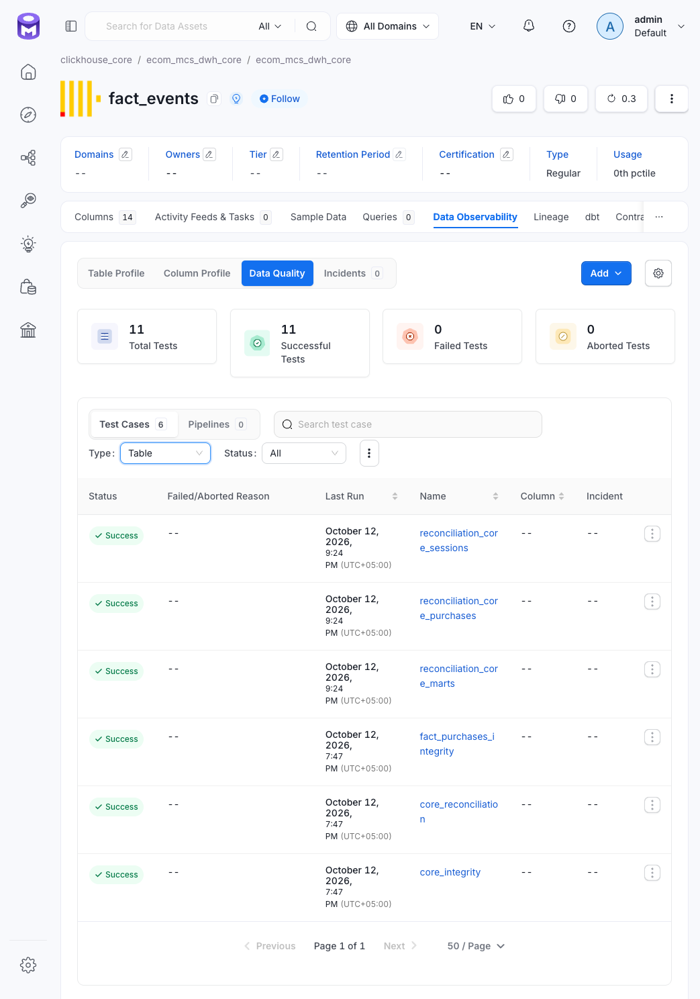
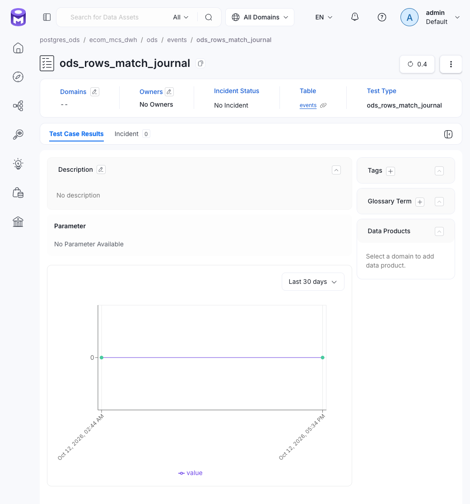

# OpenMetadata — каталог данных и витрина качества

## 1. Назначение

OpenMetadata (OM) — единая витрина метаданных и качества данных хранилища `ecom_mcs_dwh`. Она отображает тест-кейсы, результаты проверок, измерения качества, историю выполнения и связи между объектами данных.

OM не выполняет контроль качества вместо конвейера. Python-гейты и dbt-тесты проверяют данные, Airflow управляет выполнением и блокировкой последующих этапов, OpenMetadata хранит и отображает опубликованные результаты.

Сервер проекта использует OpenMetadata версии `1.13.x`. Запросы выполняются от служебного пользователя `ingestion-bot` с JWT-токеном. Секрет берётся из конфигурации проекта `om.token` или переменной окружения `OM_TOKEN`.

## 2. Архитектура интеграции

В проекте используются два потока метаданных:

| Поток | Что передаёт | Реализация |
|---|---|---|
| OpenLineage | Источники и связи между объектами данных | `src/lineage/ol.py` и специализированные эмиттеры |
| Data Quality API | Определения тестов, тест-кейсы и результаты проверок | `src/lineage/dq.py`, dbt-коннектор и `src/lineage/emit_dbt_test_results.py` |

OpenLineage передаёт сведения о происхождении данных. Data Quality API регистрирует проверки и результаты. Эти потоки решают разные задачи, даже если в интерфейсе OM они представлены рядом.

## 3. Потоки публикации данных в OM

| Поток | Что передаёт | Когда выполняется | Поведение при сбое публикации |
|---|---|---|---|
| `src/lineage/dq.py` — прямые REST API-вызовы | Кейсы и результаты Python-гейтов | Внутри `test_csv_ods`, `test_ods_core` | Ошибка публикации логируется как предупреждение, основной статус задачи не должен подменяться ошибкой OM |
| dbt-коннектор OM: `dbt/ingestion/dbt_core.yml`, `dbt/ingestion/dbt_marts.yml` | Поддерживаемые кейсы и результаты dbt-тестов | `ingest_dbt_tests` | Ошибка ingestion может привести к статусу `Failed` у задачи Airflow |
| `src/lineage/emit_dbt_test_results.py` | Результаты выбранных reconciliation-тестов, пропущенных коннектором | `push_dbt_test_results`, после `ingest_dbt_tests` | Предупреждение в логе, скрипт не должен заменять результат выполнения dbt |
| `src/lineage/ol.py` через `emit_csv_lineage`, `emit_spark_lineage`, `emit_dbt_lineage` | CSV-сущности и связи между объектами | Соответствующие lineage-задачи DAG | Ошибка эмиссии обрабатывается как предупреждение |

Все потоки создают или обновляют тест-кейсы и результаты в OM. Поэтому на странице одной таблицы могут находиться кейсы, опубликованные разными механизмами, а интерфейс не обязательно показывает, каким именно путём был создан каждый кейс.



Рис. Все пути дают один и тот же вид тест-кейсов в интерфейсе OM

### 3.1. Результаты Python-гейтов

Компоненты: `src/lineage/dq.py`, `test_csv_ods`, `test_ods_core`.

Python-гейты проверяют данные на границах этапов:

- `CSV -> ODS`;
- `ODS -> Core`.

Результаты публикуются прямыми вызовами REST API OpenMetadata. В реализации проекта ошибки публикации обрабатываются как предупреждения, поэтому сбой OM не должен подменять результат самой DQ-проверки.

Карточки проверок:

- [`CSV -> ODS`](tests/gates/csv_ods_check.md);
- [`ODS -> Core`](tests/gates/integration_check.md).

### 3.2. Generic- и singular-тесты dbt

Компоненты: `dbt/ingestion/dbt_core.yml`, `dbt/ingestion/dbt_marts.yml`.

dbt-коннектор OpenMetadata читает артефакты dbt и публикует поддерживаемые тест-кейсы и результаты. Для Core и Marts используются отдельные конфигурации ingestion.

Коннектор не гарантирует автоматическую публикацию каждого возможного dbt-теста: результат зависит от того, может ли он определить таблицу, к которой относится тест.

### 3.3. Reconciliation-тесты dbt

Компонент: `src/lineage/emit_dbt_test_results.py`.

Почему нужна отдельная публикация reconciliation-тестов?

dbt-коннектор определяет таблицу, к которой относится тест, по его зависимостям. Если тест одновременно использует модель через `ref` и источник через `source`, коннектор может не выбрать однозначный объект и пропустить тест-кейс.

Примеры таких тестов:

- `reconciliation_core_marts`;
- `reconciliation_core_purchases`;
- `reconciliation_core_sessions`.

dbt выполняет эти тесты как обычно. Проблема касается отображения результатов в OM, а не самого выполнения проверки.

Скрипт закрывает этот пробел:

1. читает `run_results.json`;
2. выбирает тесты из белого списка `PUSH_CASES`;
3. для каждого теста использует явно заданную таблицу-носитель;
4. отправляет определение теста и результат через `dq.py`.

Если тест отсутствует в `run_results.json`, скрипт выдаёт предупреждение и не отправляет новый результат. Это может означать, что dbt не дошёл до теста из-за более ранней ошибки.



Рис. На `fact_events` рядом отображаются кейсы, опубликованные коннектором и отдельным скриптом.

#### Правило сопровождения (`PUSH_CASES`)

При добавлении dbt-теста с зависимостями `ref` и `source` нужно проверить, публикует ли его установленная версия коннектора.

- Если коннектор пропускает тест, добавить его имя и таблицу-носитель в `PUSH_CASES`.
- Если после обновления OM-коннектор начинает создавать кейс самостоятельно, удалить тест из `PUSH_CASES`, иначе появится дублирование.


### 3.4. Lineage

Компоненты: `src/lineage/emit_csv.py`, `src/lineage/emit_spark.py`, `src/lineage/emit_dbt.py`, `src/lineage/ol.py`.

Эмиттеры публикуют связи между CSV-источниками, этапами обработки и dbt-моделями через OpenLineage.

Lineage отражает заявленные зависимости и переданные события. Сам факт наличия связи в OM не подтверждает, что DQ-gate прошёл успешно или что данные полностью загружены.


## 4. Контракт Data Quality API

Скрипты `dq.py` и `emit_dbt_test_results.py` используют API OpenMetadata версии `1.13.x`.

| Метод и endpoint | Назначение | Основные данные |
|---|---|---|
| `PUT /dataQuality/testDefinitions` | Создание или обновление определения теста | Определение и `dataQualityDimension` |
| `PUT /dataQuality/testCases` | Создание или обновление тест-кейса | `name`, `testDefinition`, `entityLink`, `parameterValues`, `description` |
| `POST /dataQuality/testCases/testCaseResults/{fqn}` | Публикация результата | `timestamp` в миллисекундах, `testCaseStatus`, `result`, `testResultValue` |


Рис. Пример итога POST testCaseResults

Test suite назначается сервером. Полное имя тест-кейса формируется из полного имени таблицы и имени теста:

```text
<FQN таблицы>.<имя теста>
```

Оба `PUT`-запроса используются для идемпотентного создания или обновления сущностей. Повторная отправка с тем же именем обновляет соответствующий объект, дубликатов не создаёт.

Удаление кейса выполняется через `DELETE` с параметром `hardDelete=true`. Без этого параметра сущность получает мягкое удаление и может оставаться в списке с признаком `deleted`.

### Диагностика ошибок API

Контракт меняется между версиями OM. Ответ `400 Invalid request format` означает, что тело запроса не соответствует ожиданиям текущей версии. Нужно сверить поля с API-контрактом установленной версии и поправить словарь в `dq.py`.

Другие распространённые причины:

- `401` — проблема авторизации или истёкший токен;
- `connection refused` — сервер недоступен или соединение не установлено;
- отсутствие тест-кейса — таблица-носитель ещё не создана в каталоге или тест пропущен коннектором.

## 5. Измерения качества и Data Assets Coverage

### Измерения

`dimension` — смысловой класс проверки. В проекте используются:

| Измерение | Значение |
|---|---|
| `Completeness` | Полнота |
| `Validity` | Допустимость значений |
| `Uniqueness` | Уникальность |
| `Integrity` | Целостность |
| `Consistency` | Согласованность |
| `Accuracy` | Точность |

Для dbt-тестов измерение назначается патчем коннектора `_DBT_DIMENSION` на основе подстроки имени теста. Для Python-гейтов оно задаётся явно при публикации результата.

Конвенции имён и соответствие им измерений см. в [naming.md](naming.md). Реализация патча см. в [om_dbt_connector_patch.md](om_dbt_connector_patch.md).

### Покрытие

**Data Assets Coverage** — доля таблиц, у которых зарегистрирован хотя бы один тест-кейс. Кейс может поступить от generic-теста, singular-теста или Python-гейта.

Это показатель наличия покрытия на уровне объекта, а не полноты проверок каждой колонки и не доля успешно пройденных тестов.

Например, таблица `ingestion.journal` может получить покрытие от табличного кейса `journal_batch_loaded`, даже если для отдельных колонок не зарегистрировано ни одного теста.

Чтобы выяснить, какие именно свойства таблицы проверяются см. [сводную матрицу тестов](tests/README.md), а не метрику покрытия OM.

## 6. Последовательность задач Airflow

В активном DAG публикация метаданных встроена в конвейер:

```text
process_csv_ods
    ↓
emit_csv_lineage
    ↓
test_csv_ods
    ↓
process_ods_core
    ↓
emit_spark_lineage
    ↓
test_ods_core
    ↓
refresh_dbt_manifest
    ↓
process_dbt
    ↓
emit_dbt_lineage
    ↓
ingest_dbt_tests
    ↓
push_dbt_test_results
```

Порядок принципиален:

- `emit_csv_lineage` выполняется до `test_csv_ods`;
- `emit_spark_lineage` выполняется до `test_ods_core`;
- dbt lineage публикуется после dbt-группы;
- `ingest_dbt_tests` выполняется перед `push_dbt_test_results`, чтобы дополнительная публикация использовала уже созданные коннектором кейсы.

Команды Core и Marts ingestion выполняются последовательно в одной Bash-задаче с `&&`. Если Core ingestion завершается ошибкой, Marts ingestion не запускается и задача возвращает ошибку.

Подробное описание DAG и настроек Cosmos см. в [Airflow](../architecture/airflow.md).

## 7. Конфигурация dbt-коннектора

Используются два ingestion-конфига:

- `dbt/ingestion/dbt_core.yml`;
- `dbt/ingestion/dbt_marts.yml`.

Они задают dbt как источник, артефакты `manifest.json` и `run_results.json`, а также sink `metadata-rest`. Пути к артефактам должны соответствовать фактическому `target-path`, настроенному для запуска Cosmos; при изоляции каталогов используется путь вида `target/<task_id>/...`.

Токен авторизации JWT берётся из конфигурации или переменной окружения. Патч `_DBT_DIMENSION` назначает измерения dbt-тестам по имени.

## 8. Диагностика «в OM не появилось»

Проверять последовательно:

1. Выполнялся ли тест. Найти его в логах Python-гейта или в `run_results.json`;
2. Завершилась ли задача успешно. Проверить лог соответствующей задачи Airflow: `test_csv_ods`, `test_ods_core`, `process_dbt`, `ingest_dbt_tests` или `push_dbt_test_results`. `WARNING ... OM` — в предупреждении тело ответа сервера. Например, недоступен сервер или истёк токен — connection refused, 401;
3. Создан ли объект данных (таблица-носитель). Кейс без существующего объекта-носителя не сможет корректно связаться с таблицей. Например, CSV-сущность регистрируется задачей `emit_csv_lineage`, поэтому она предшествует `test_csv_ods`;
4. Что ответил API. Проверить логи и тело ответа: `401`, `400 Invalid request format`, `connection refused` и другие ошибки требуют разных действий;
5. Не пропущен ли тест коннектором. Для тестов с одновременными зависимостями `ref` и `source` проверить `PUSH_CASES`;
6. Назначено ли измерение. Проверить патч `_DBT_DIMENSION` и правила из `naming.md`;
7. Не нарушен ли порядок публикации. `ingest_dbt_tests` должен предшествовать `push_dbt_test_results`.

Подробные runbook-процедуры в [procedures.md](procedures.md).
Проверка патча в [om_dbt_connector_patch.md](om_dbt_connector_patch.md)

## 9. Ограничения

- OM отображает результаты, но не заменяет блокирующие проверки в конвейере;
- Ошибка публикации метаданных не обязательно означает ошибку трансформации данных, и наоборот, успешная публикация не означает успешный DQ-результат;
- Коннектор может пропустить dbt-тест с неоднозначными зависимостями;
- Порядок `ingest_dbt_tests` -> `push_dbt_test_results` необходимо сохранять, чтобы избежать дублирования кейсов;
- Data Assets Coverage отражает наличие кейсов на объектах, а не полноту колоночного покрытия;
- API-контракт и поведение коннектора следует перепроверять при обновлении версии OpenMetadata.

## Связанные документы

- [Контроль качества](README.md)
- [Архитектура контроля качества](architecture.md)
- [Сводная матрица тестов](tests/README.md)
- [Правила именования тестов](naming.md)
- [Процедуры сопровождения](procedures.md)
- [Патч dbt-коннектора](om_dbt_connector_patch.md)
- [Airflow](../architecture/airflow.md)
- [dbt](../architecture/dbt.md)