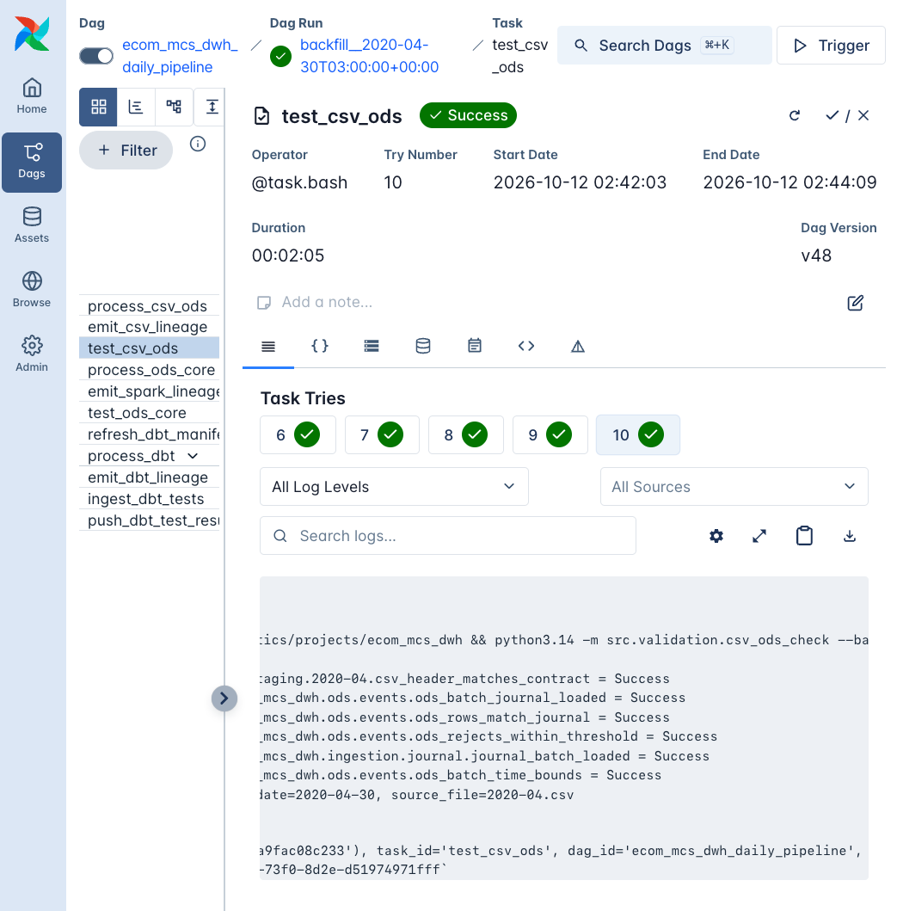
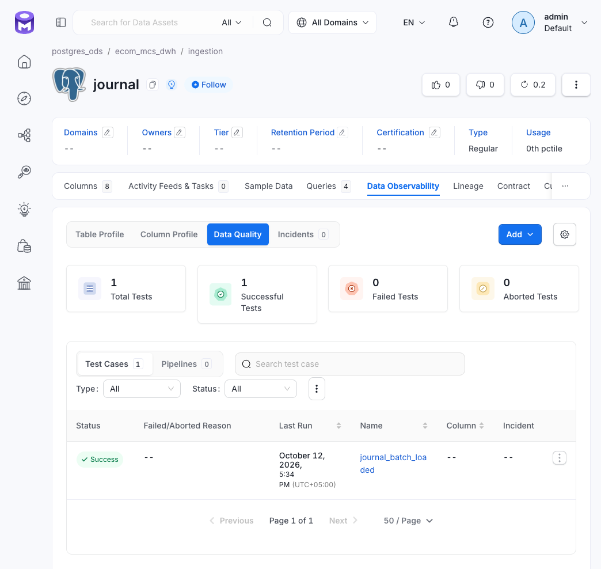

# `csv_ods_check` — гейт `CSV -> PostgreSQL ODS`

- **Файл:** `src/validation/csv_ods_check.py`.
- **Airflow-таск:** `test_csv_ods`. Запускается после `emit_csv_lineage`, чтобы CSV-сущность уже была зарегистрирована в OM и результаты можно было привязать к ней.
- **Периодичность:** ежедневный запуск; `batch_date = ds`.

## Что защищает

Гейт проверяет загруженный день:

- полноту загрузки и отсутствие дублирования строк;
- соответствие заголовка контракту;
- принадлежность событий своим суткам;
- допустимый уровень отклонённых строк.

Рис. Лог `test_csv_ods`: проверки `CSV -> ODS` завершились успешно

При `Failed` данные ODS не считаются проверенными, и PySpark не запускается.

## Проверки

### `csv_header_matches_contract` — Validity

- Заголовок CSV совпадает с `_SOURCE_COLUMNS` в `load_ods` по составу и порядку. Staging собирается позиционно, поэтому перестановка колонок может привести к тихой подмене значений.
- **Провал:** изменился контракт источника.
- **Действие:** проверить изменение и обновить контракт в `load_ods`; см. [procedures.md](../../procedures.md), раздел 4.

### `ods_batch_journal_loaded` — Completeness

- В `ingestion.journal` есть запись со статусом `loaded` для пары `(source_file, batch_date)`.
- **Провал:** день не загружен или загрузка завершилась некорректно.
- **Действие:** проверить лог `load_ods` и при необходимости перезагрузить день.

### `journal_batch_loaded` — Completeness

- Проверяет агрегированное состояние журнала: статус загрузки и допустимость отклонённых строк. Носитель кейса — `ingestion.journal`.
- **Провал:** журнал не подтверждает корректное завершение загрузки или содержит недопустимое число отклонённых строк.
- **Действие:** проверить запись журнала и соответствующие параметры загрузки.

Рис. Кейс `journal_batch_loaded` закрывает покрытие `ingestion.journal` в OM

### `ods_rows_match_journal` — Consistency

- Число строк `ods.events` для `(batch_date, source_file)` равно `journal.rows_loaded`. Эталон — журнал, а не зашитая константа.
- **Провал:** число строк ODS больше ожидаемого — возможны дубли; меньше ожидаемого — возможна потеря строк или внешнее вмешательство.
- **Действие:** провести аудит и при необходимости перезагрузить день; см. [procedures.md](../../procedures.md), раздел 2.

### `ods_rejects_within_threshold` — Accuracy

- `journal.rows_rejected` не превышает `validation.max_rows_rejected`, по умолчанию `0`. Карантин не допускает некорректные строки в основные данные, но превышение порога сигнализирует о проблеме источника или загрузки.
- **Провал:** число отклонённых строк превышает допустимое.
- **Действие:** изучить rejects-файлы в `staging`; менять порог только после согласования.

### `ods_batch_time_bounds` — Validity

- `min(event_time)` и `max(event_time)` находятся в интервале `[batch_date 00:00, batch_date + 1 сутки)` UTC.
- Проверка выявляет строки, маршрутизированные не в свои сутки, в том числе из-за ошибок границ партиций или временных смещений.
- **Провал:** временные границы ODS не соответствуют batch.
- **Действие:** исследовать загрузку; не исправлять строки вручную без установления причины.

## Причины раннего сбоя

- Нет строки в журнале. Гейт отправляет в OM результаты тех проверок, которые удалось вычислить, включая заголовок, проверки журнала и временные границы, затем завершает работу с ошибкой.
- Нет CSV-файла. Для пустого месяца бэкфилла выполняется тихий skip, как и у эмиттера.