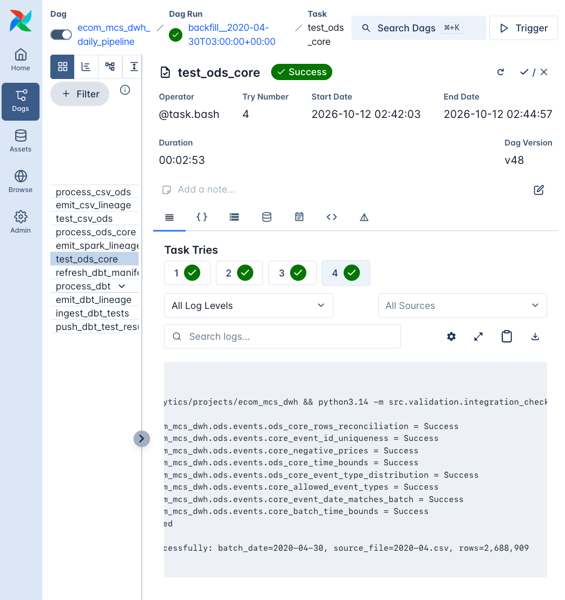

# `integration_check` — гейт `ODS -> ClickHouse Core`

- **Файл:** `src/validation/integration_check.py`.
- **Airflow-таск:** `test_ods_core`, запускается после `process_ods_core` и `emit_spark_lineage`.
- **Периодичность:** ежедневный запуск; `batch_date = ds`, `source_file` — имя файла месяца.

## Что защищает

Гейт проверяет корректность переноса `ODS -> Core` через PySpark:

- дедупликация соответствует заданному правилу;
- строки не потеряны и не добавлены;
- ключи и значения корректны;
- временные границы и распределение типов событий согласованы.

Рис. Лог Airflow-таска `test_ods_core`.

При `Failed` Core не считается проверенным, dbt не запускается и витрины не пересчитываются.

### Метод проверки

Гейт сначала вычисляет все доступные проверки, затем собирает провалы в один результат. Полный список нарушений попадает в исключение и отправляется в OM, а не только первое обнаруженное нарушение.

Выборка ODS выполняется по временному окну суток batch (`event_time`), а не по `_batch_date`. Это позволяет сверять именно события в пределах суток. Эквивалентность временного окна и `_batch_date` контролируется гейтом `test_csv_ods` через `ods_batch_time_bounds`. Если предпосылка нарушится, сверки обнаружат расхождение и гейт остановит конвейер.

## Проверки

### `ods_core_rows_reconciliation` — Consistency

- Число строк Core равно числу уникальных событий ODS за сутки batch по полному набору из девяти полей.
- Эталон вычисляется на стороне ODS с тем же правилом полного совпадения строк, которое используется при дедупликации PySpark.
- **Провал:** строки потеряны или добавлены при трансформации.

### `core_event_id_uniqueness` — Uniqueness

- `uniqExact(event_id) = count()` для batch в Core.
- **Провал:** возможна коллизия при генерации `event_id` или повторная запись batch.
- **Действие:** проверить генерацию ключей и логи загрузки Core.

### `core_negative_prices` — Validity

- `countIf(price < 0) = 0`.
- **Провал:** нарушен бизнес-инвариант цены.

### `ods_core_time_bounds` — Consistency

- Минимальный и максимальный `event_time` в Core совпадают с соответствующими значениями ODS после дедупликации.
- Вместе с `core_batch_time_bounds` проверка выявляет и расхождение между слоями, и ситуацию, когда границы не соответствуют ожидаемым суткам.

### `ods_core_event_type_distribution` — Consistency

- Распределение по `event_type` в Core совпадает с распределением ODS.
- Проверка строже простого контроля допустимых значений: она выявляет перекосы, например потерю всех событий `purchase`.

### `core_allowed_event_types` — Validity

- `event_type` принадлежит множеству `{view, cart, remove_from_cart, purchase}`.
- **Провал:** в Core попал неизвестный тип события.

### `core_event_date_matches_batch` — Validity

- `event_date = _batch_date` для всех строк batch; `event_date` — календарная дата события в принятой проектом временной семантике.
- **Провал:** нарушена маршрутизация событий по дням.

### `core_batch_time_bounds` — Validity

- `event_time` находится в границах суток batch.
- В отличие от сверки с ODS, проверка контролирует абсолютные временные границы.

## Причины раннего сбоя

Если batch не найден или база недоступна, гейт отправляет агрегированный кейс `ods_core_integration_check` со статусом `Failed` и dimension Consistency. Полный traceback доступен в логе Airflow-таска.