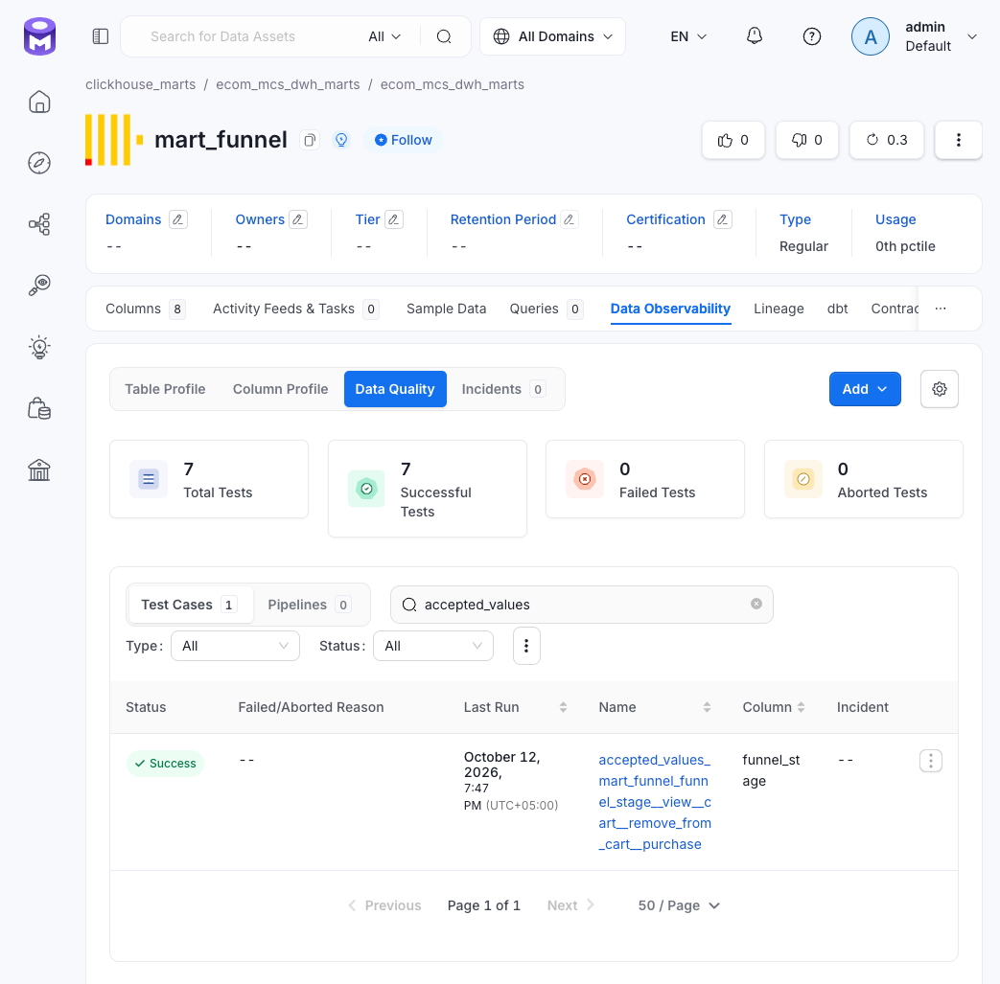
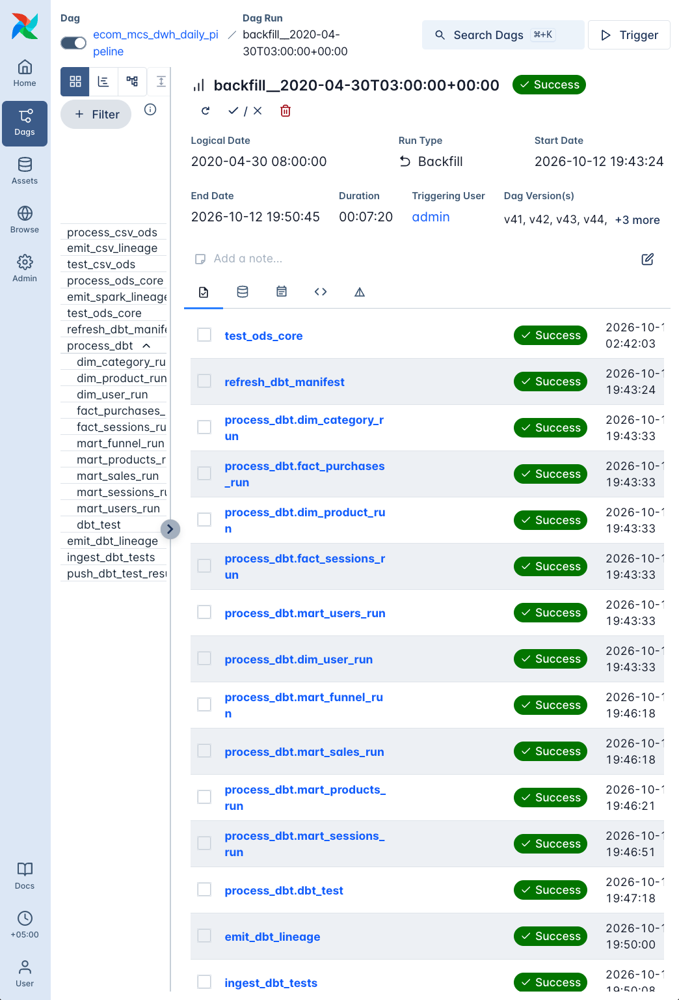

# dbt generic-тесты

Generic-тесты задают декларативные свойства колонок в `schema.yml`. В проекте используются файлы `dbt/models/core/schema.yml` и `dbt/models/marts/schema.yml` — это соглашение проекта, а не требование dbt.

- Карточки сгруппированы по слоям;
- Каждая декларация теста (строка в yml) создаёт отдельную проверку. Имя обычно формируется dbt по шаблону `<тип>_<модель>_<колонка>`, итоговое имя может включать хеш, например в OM.

Рис. OM: generic-кейс `accepted_values` для `funnel_stage` в `mart_funnel`.

## Выполнение

Generic-тесты запускаются вместе с singular-тестами в общем прогоне `dbt build` в режиме Cosmos `AFTER_ALL`: сначала строятся модели, затем выполняются тесты. Провал делает `process_dbt` красным и останавливает нисходящие таски DAG. Витрины к этому моменту уже материализованы.

Рис. Airflow: модели построены DbtTaskGroup `process_dbt`, затем выполнен общий прогон `dbt_test`.

Провал `not_null` или `unique` на Core часто указывает на проблему предыдущего этапа. Сначала следует проверить лог гейта `test_ods_core`, а затем — модель и тест.

## Покрытие в OM

Data Assets Coverage — доля таблиц, у которых есть хотя бы один тест-кейс. Покрытие может обеспечиваться generic-тестом, singular-тестом или кейсом Python-гейта. Например, таблица `ingestion.journal` покрыта кейсом `journal_batch_loaded`, даже если у неё нет колоночных generic-тестов.

Карточки:

- [core.md](core.md) — generic-тесты Core.
- [marts.md](marts.md) — generic-тесты витрин.