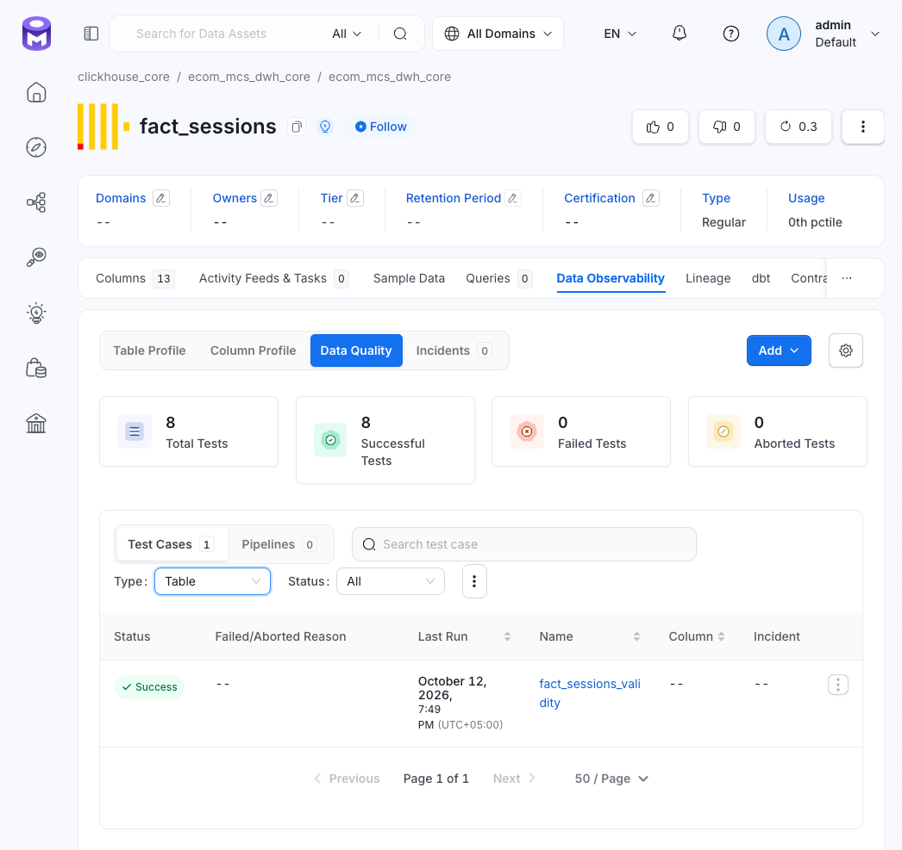

# dbt singular-тесты

- Один SQL-файл соответствует одной проверке.
- Имя файла совпадает с именем теста и следует соглашению [naming.md](../../naming.md).
- Тест возвращает строки-нарушители: пустой результат означает успех.

## Видимость в OpenMetadata

dbt-коннектор создаёт кейс, когда может определить таблицу-носитель по зависимостям теста:

- Тест использует только модели через `ref` — коннектор может создать кейс.
- Тест одновременно использует модель через `ref` и источник через `source` — коннектор не может однозначно выбрать таблицу, поэтому кейс не создаётся автоматически.

Ко второй группе относятся, например, `reconciliation_core_marts`, `reconciliation_core_purchases` и `reconciliation_core_sessions`. dbt выполняет их и блокирует конвейер при провале так же, как остальные тесты. Для отображения результатов отдельный Airflow-таск `push_dbt_test_results` запускает `src/lineage/emit_dbt_test_results.py` и публикует их в OM на `fact_events`.

Рис. OM: Singular-кейс `fact_sessions_validity` на `fact_sessions`, созданный dbt-коннектором.

## Карточки по слоям

- [core.md](core.md) — Core.
- [dimensions.md](dimensions.md) — измерения.
- [facts.md](facts.md) — факты.
- [marts.md](marts.md) — витрины.